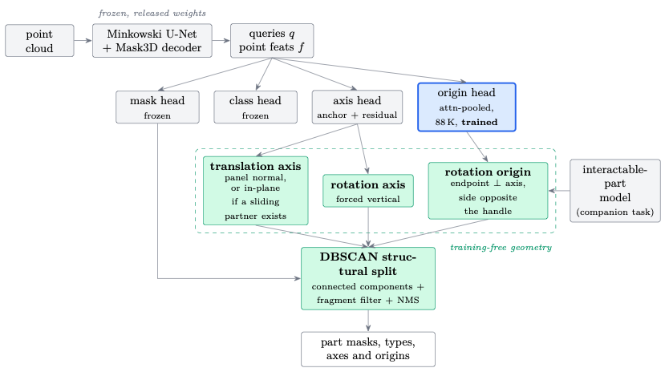
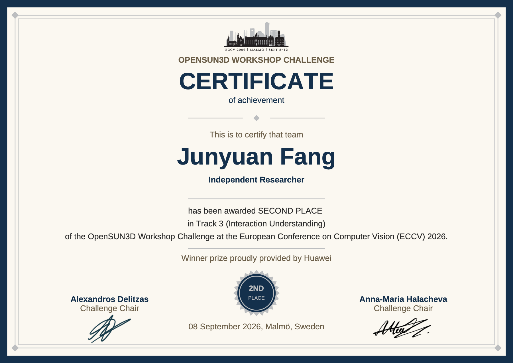

# Articulate3D Challenge (OpenSUN3D @ ECCV 2026, Track 3)

[Official challenge results](https://opensun3d.github.io/#winners) · [Full report](paper/main.pdf) · [Short report](paper/tech_report/tech_report.pdf) · [Citation](#citation)

Solution, technical report, and reproducible environment for the Articulate3D challenge:
segment every movable / interactable part in a ScanNet++ indoor scan and predict its
articulation (rotation / translation, axis, origin).

## Final standing (leaderboards frozen 2026-08-28)

| Board | Ranking metric | Ours | Rank | Baseline (USDNet) |
|---|---|---|---|---|
| Movable — dev  | AP50_axis_origin | **0.5038** | 1st | — |
| Movable — test | AP50_axis_origin | **0.4056** | 2nd (TnG 0.4828) | 0.2640 |
| Interaction — dev  | AP50 | **0.6446** | 1st | — |
| Interaction — test | AP50 | **0.3286** | 2nd (TnG 0.3446) | 0.2686 |

## Method in one paragraph

The initial geometry-based recipe freezes the USDNet backbone, decoder, mask and class heads
(including BatchNorm statistics), trains an 88K-parameter attention-pooled origin head, and
refines articulation with geometric priors: panel-PCA translation axes, vertical rotation axes,
and origins snapped to the mask endpoint opposite the handle. Offline DBSCAN splitting,
fragment filtering and NMS refine the instances. The final stage additionally finetunes the
network with augmentation: `mov_v11` reaches **0.4056** on movable test, while the three-model
interaction ensemble (`v5` + `v6` + `v5b`) reaches **0.3286**. The earlier two-model interaction
ensemble reached **0.3240**.
Full write-up: [long report](paper/main.pdf) (LaTeX source [main.tex](paper/main.tex)).

## Method pipeline

<p align="center">
  <a href="paper/tech_report/tech_report.pdf">
    
  </a>
</p>

Original pipeline from the [technical report](paper/tech_report/tech_report.pdf).
Grey: frozen components; blue: trained origin head; green: training-free geometry and structural post-processing.

## Layout

```
paper/            technical report: main.tex, refs.bib, figs/, main.pdf
docs/             working notes 01-08 (environment, data, submission, diagnosis, finetune design,
                  SOTA options incl. the c2f / BatchNorm pitfalls);
                  docs/award/ holds the challenge certificate (PDF + PNG)
usdnet_patch/     our changes to the USDNet baseline, kept apart from upstream code:
                  usdnet_0ba303d.patch (edits to 10 upstream files), addons/ (files we added),
                  setup_usdnet.sh (fetches upstream insait-institute/USDNet@0ba303d into USDNet/
                  and applies both). Upstream code itself is not in this repo.
scripts/          endgame scripts: {inter,mov}_pp_grid.py DBSCAN post-processing grids (official
                  evaluator metric), training supervisors, checkpoint snapshotters
analysis/         per-instance error forensics, geometric-rule gates, sweeps, flip-TTA merge,
                  BN buffer restore; JSON results of the diagnosis (per-instance ground-truth
                  values removed; rerun diagnose_arti_errors.py on the data to regenerate)
data_download/    ScanNet++ / Articulate3D download + preprocessing tooling and split list
env/              environment, see below
```

## Environment (`env/`)

The upstream repo targets CUDA 11.3 / torch 1.12, which does not run on an RTX 5090 (sm_120).
What actually ran the challenge:

| File | What |
|---|---|
| `env/env.sh` | source this: sets CUDA_HOME to the conda env's nvcc 12.8, TORCH_CUDA_ARCH_LIST=12.0, activates `usdnet` |
| `env/usdnet_conda_export.yml` | version snapshot of `usdnet`, migrated to conda-forge/NVIDIA channels (rebuild unvalidated) |
| `env/usdnet_pip_freeze.txt` | `pip freeze` of the same env (torch 2.7.1+cu128, MinkowskiEngine 0.5.8 built for sm_120) |
| `env/hardware.txt` | GPU / driver / torch / MinkowskiEngine versions |
| `env/README_environment.md` | how the env was built and every pitfall hit on the way |
| `env/environment_upstream_cu113.yml`, `env/Dockerfile_upstream` | upstream-derived environment, migrated to Miniforge/conda-forge (rebuild unvalidated) |

Quick start (after downloading data per `docs/02-data.md` and the released USDNet checkpoints):

```bash
bash usdnet_patch/setup_usdnet.sh     # creates USDNet/ = upstream@0ba303d + our patch + addons
source env/env.sh
cd USDNet
bash scripts/infer_mov_val.sh          # val evaluation, bit-identical to the server
bash scripts/infer_mov_test_v2.sh      # test inference -> submission zip
python ../scripts/mov_pp_grid.py       # DBSCAN post-processing grid
```

## Running on a 24 GB GPU

Stock USDNet training OOMs on a 24 GB card (RTX 5090 D). What made it fit:

1. **Aggregation rewrite in the articulation head** (`USDNet/models/mask3d.py`, the actual code fix;
   see `usdnet_patch/usdnet_0ba303d.patch`).
   The per-query mean over masked points was computed by expanding per-point features to a
   `(batch, points, queries, 3)` tensor, multiplying by the mask and summing: ~120 MB each at
   100k points x 100 queries, twice, both kept alive for backward. It is now
   `einsum("bnq,bnd->bqd", mask, per_point)`, which only materialises `(b, n, q)` and `(b, n, 3)`.
   The attention-pooled origin head (`_origin_attention`) follows the same rule.
   `analysis/test_einsum_equiv.py` checks the rewrite is numerically identical to the original.
2. **Allocator**: `PYTORCH_CUDA_ALLOC_CONF=expandable_segments:True` (an OOM showed 5.4 GB
   reserved but unallocated, i.e. fragmentation).
3. **Crop 4.0 m / min 30k points** instead of 5.5 m. At 5.5 m, 31% of training scenes give crops
   above 300k points and MinkowskiEngine's sparse convolution OOMs. 4.0 m still holds the largest
   movable part (3.50 m). Gradient checkpointing does not help here: the backbone is frozen and
   stores no activations. Short OOM tests are not enough; peak memory is set by the largest crop,
   and one run died at 97% of epoch 0. Details: `docs/06-finetune-design.md` section 11.
4. **Full-network finetunes run without in-training validation** (`train_full_aug.sh`,
   `train_inter_aug.sh`): AdamW state (~19 GB) and whole-scene val inference (>9 GB) do not fit
   together, so checkpoints are saved every few epochs and selected offline.

Also: whole-scene inference needs >9 GB, so do not run it next to training; and stop runs with
`USDNet/kill_runs.sh`, which also kills orphaned dataloader workers that otherwise keep ~19 GB.

## Not included

Datasets (ScanNet++, Articulate3D annotations), preprocessed data, checkpoints, prediction
pickles, EvalAI tokens. Paths inside scripts still point at the original machine layout
(`/data/challenge/...`); adjust as needed.

## Award

**2nd place, Track 3 (Interaction Understanding)**, OpenSUN3D Workshop Challenge, ECCV 2026
(Malmö, 8 September 2026).

<p align="center">
  <a href="docs/award/opensun3d_eccv2026_track3_2nd_place.pdf">
    
  </a>
</p>

## Acknowledgement

The solution builds on the USDNet / Articulate3D codebase and the ScanNet++ dataset. Thanks also
to the OpenSUN3D challenge organizers for running the challenge and the evaluation server.

## Citation

If you find this code or our geometric refinement approach useful in your research,
please consider citing this repository:

```bibtex
@software{fang_articulate3d_challenge,
  author = {Fang, Junyuan},
  title = {{Articulate3D Challenge (OpenSUN3D at ECCV 2026, Track 3)}},
  url = {https://github.com/junyuan-fang/articulate3d}
}
```

The repository citation is also available through [CITATION.cff](CITATION.cff).
For reproducibility, record the commit used alongside the citation. The reports are
available above; a paper citation will be added when a formal publication identifier
is available. No arXiv identifier or DOI has been assigned in this repository.

## License

MIT, see `LICENSE`. This repo does not include upstream USDNet code; `setup_usdnet.sh` fetches it
from its official repository. The patch modifies upstream USDNet (MIT, notice kept in
`usdnet_patch/LICENSE-USDNet`).

Third-party evaluation code retains its upstream notices; see [THIRD_PARTY_NOTICES.md](THIRD_PARTY_NOTICES.md).
